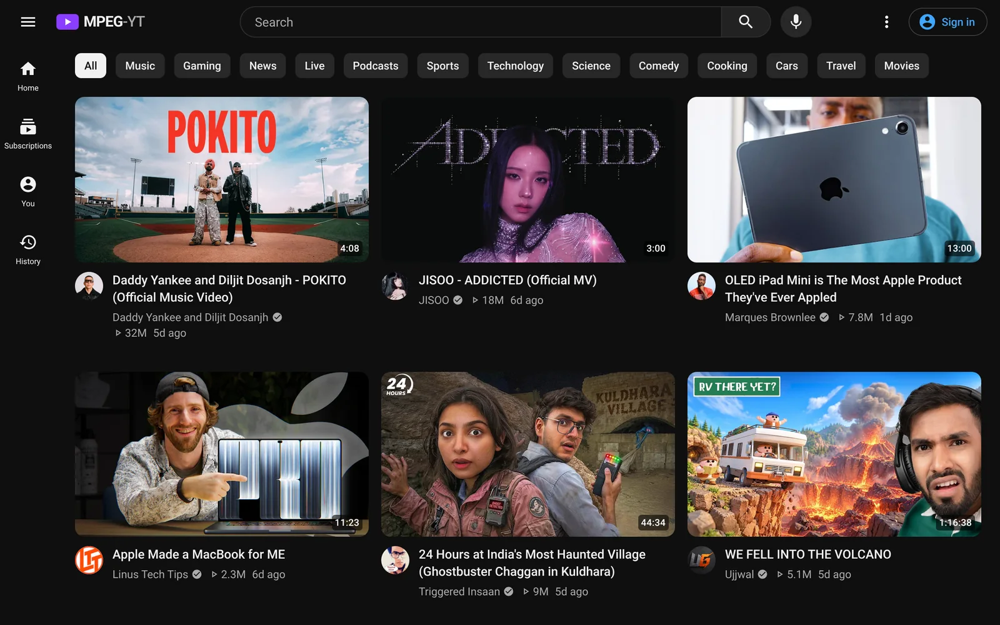
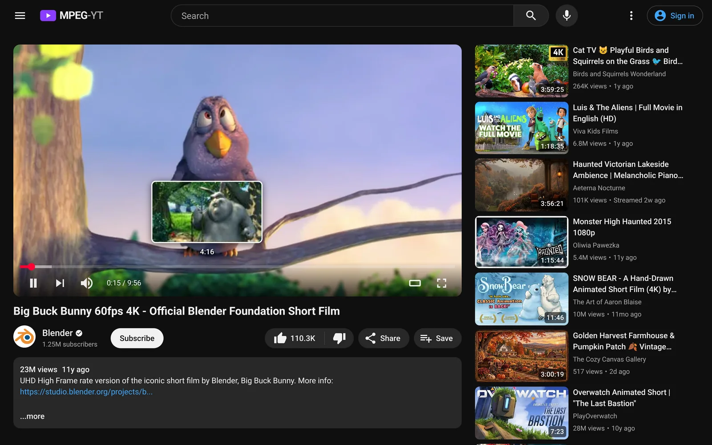
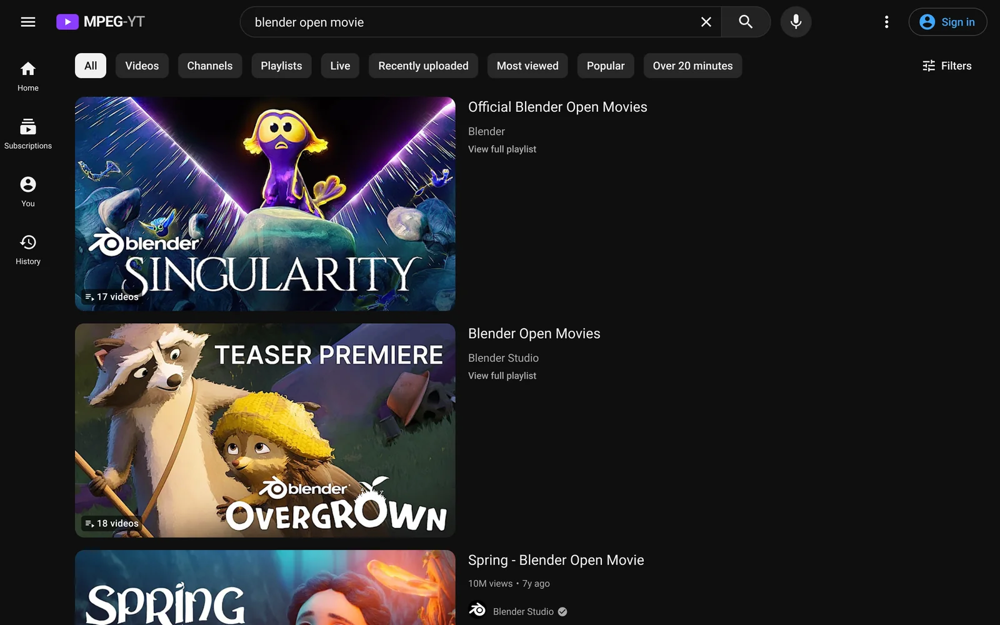
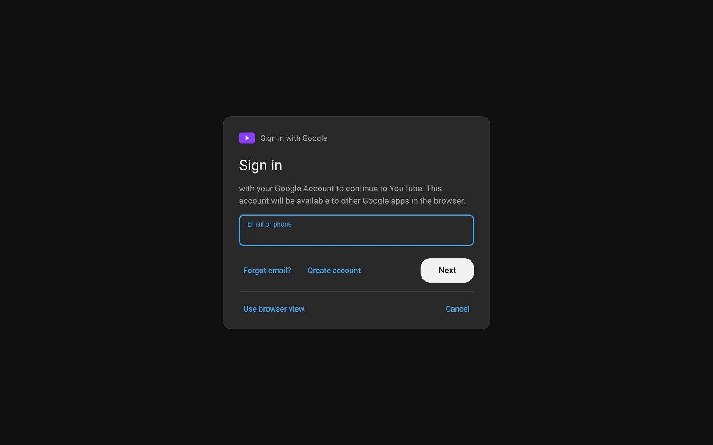
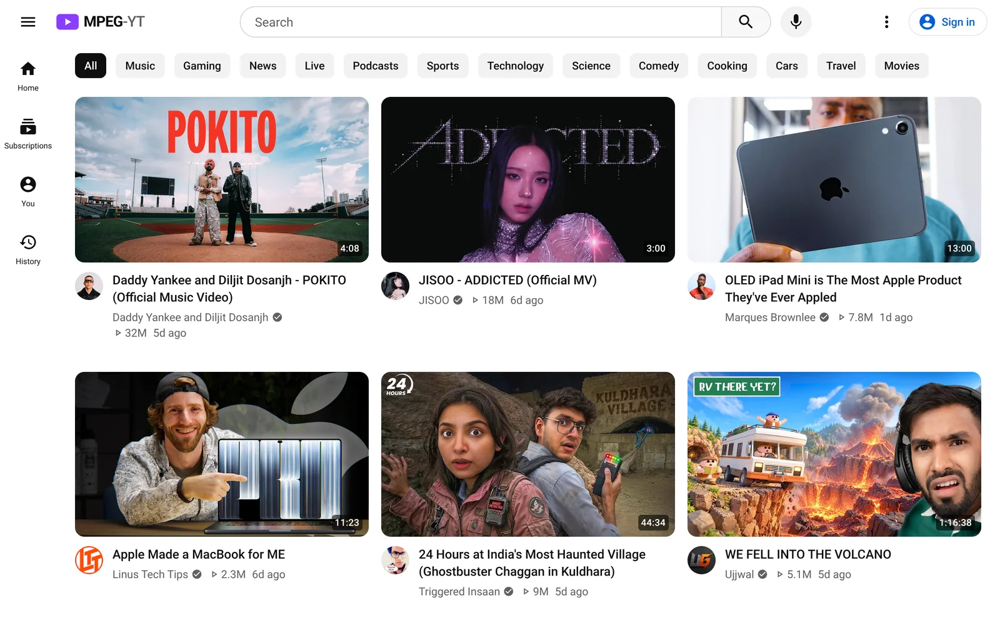

# MPEG-YT

A self-hosted YouTube client that plays video **without a `<video>` element**. Video is decoded in
WebAssembly and drawn on a WebGL `<canvas>`, so it plays in browsers that block or restrict the video
element, such as some in-car, kiosk and other locked-down browsers.

It looks and feels like YouTube. It's built for tablets and works on desktop. Browsing is a native web app
driven by YouTube's own data, so you get the real home feed, recommendations, view counts and dates.
**Only the video** goes through the streaming pipeline:

```
YouTube (yt-dlp) ─► ffmpeg ─ MPEG-1 720p/30 + MP2 audio in MPEG-TS ─► WebSocket ─► JSMpeg (WASM) ─► WebGL <canvas>
                                                                                          └─► Web Audio
```

There is no `<video>` element anywhere in the client.



| Watch page with scrub preview | Search |
|---|---|
|  |  |
| **Sign in with Google (native form)** | **Light theme** |
|  |  |

<sub>Screenshots at tablet size (1280×800). The video is Blender's *Big Buck Bunny* (CC BY 3.0).</sub>

## Run it

GitHub Actions builds the image for **amd64 and arm64** and publishes it to `ghcr.io/amurikurthy/mpeg-yt`
(image names are always lowercase).
You only need [`docker-compose.yml`](docker-compose.yml):

```bash
mkdir mpeg-yt && cd mpeg-yt
curl -fsSLO https://raw.githubusercontent.com/amurikurthy/MPEG-YT/main/docker-compose.yml
docker compose up -d
```

Open `http://<host>:8080`, then **Sign in** (top right) to get your own recommendations. On a tablet, use
**Share → Add to Home Screen** (iPad) or **Install app** (Android) for a full-screen app.

Update with `docker compose pull && docker compose up -d`. The image is rebuilt on every push to `main` and
weekly, which keeps yt-dlp current with YouTube changes.

## Behind a reverse proxy (Pangolin, Traefik, Caddy, nginx…)

- **Target:** the proxy needs to reach the container on port **8080**. If the proxy (or Pangolin's
  **Newt**) runs in the same compose project, use the service name, e.g. `http://mpeg-yt:8080`, and you
  don't need a `ports:` mapping. Only publish `8080:8080` if something outside Docker must connect.
- **WebSockets** must be allowed. Video and the sign-in screen use them under `/api/`. Pangolin,
  Traefik and Caddy pass them through by default; nginx needs the usual `Upgrade`/`Connection` headers.
- **Health check:** `GET /healthz` returns `{"ok":true}`.
- The proxy's own login (e.g. Pangolin SSO) works as normal: the page and its WebSockets carry the proxy's
  session cookie.

Example with Pangolin's Newt in the same compose file:

```yaml
services:
  mpeg-yt:
    image: ghcr.io/amurikurthy/mpeg-yt:latest
    volumes: [./config:/config, ./cache:/cache]
    shm_size: "512mb"
    restart: unless-stopped
  newt:
    image: fosrl/newt
    restart: unless-stopped
    environment:
      PANGOLIN_ENDPOINT: https://pangolin.example.com
      NEWT_ID: ${NEWT_ID}
      NEWT_SECRET: ${NEWT_SECRET}      # keep in a .env file, not in the compose file
```

In Pangolin, set the resource target to **`http` → host `mpeg-yt` → port `8080`**, with health check
path `/healthz`.

## What's in it

- **YouTube's layout:**
  - **Home:** a big-thumbnail grid with topic chips.
  - **Navigation:** a left guide (full, mini or drawer depending on screen width).
  - **Search:** suggestions and voice search.
  - **Watch page:** Up Next, comments, the description box and theater mode.
  - **Library:** channel pages (Latest / Popular / Oldest), Subscriptions, History, Watch later, Liked
    videos, Playlists and playlist playback.
  - **Theme:** dark by default; light under **Appearance**.
- **No Shorts, no ads:** Shorts and ads or promoted items are filtered out of every feed, search and Up
  Next.
- **Endless feeds:** home, search, channels and lists keep loading as you scroll. Hung requests are
  retried, and a **Load more** button appears if YouTube stops answering.
- **YouTube's own data via InnerTube**, the API youtube.com itself uses (through
  [youtubei.js](https://github.com/LuanRT/YouTube.js)):
  - **Feeds:** your personalized home feed and its chips; Up Next is YouTube's real recommendations.
  - **Counts and dates:** "1.4M" views and "4d ago" dates, plus channel avatars.
  - **When signed in:** like, subscribe and *Save to Watch later*.
- **Search filters:** upload date, type, duration and features. **Sort by** Relevance, Popularity,
  Upload date or View count.
- **Video:** always up to **720p at 30 fps** (24/25 fps sources stay at their native rate to avoid judder).
  It starts fast, seeks without a black flash, buffers ahead smoothly, and resumes where you left off.
- **Audio:** loudness-normalized to −12 LUFS on the server, so the level is consistent from video to
  video. The player then adds +6 dB with a limiter, so 100% volume sits with other apps.
- **Touch:**
  - **Taps:** tap shows or hides the controls; double-tap the sides to skip ±10 s (taps add up).
  - **Swipe:** swipe down to leave fullscreen.
  - **Layout:** large touch targets throughout.
- **Keyboard:** `space`/`k` play/pause, `j`/`l` ∓10 s, `←`/`→` ∓5 s, `↑`/`↓` volume, `m` mute,
  `f` fullscreen, `t` theater, `Shift+N` next, `0`–`9` jump to that tenth of the video, `/` search.

## How audio works

ffmpeg loudness-normalizes the audio (EBU R128), encodes it as 48 kHz **MP2** (the native rate of
YouTube audio and most devices, so nothing is resampled) and muxes it into the same MPEG-TS
stream as the video. JSMpeg decodes it in WebAssembly and plays it through the **Web Audio API**. The audio
clock is the master clock: each video frame is shown when the audio reaches its timestamp, which keeps
lip-sync tight. Browsers block audio until you interact with the page; if that happens, a **Tap to unmute**
button appears.

The player boosts the output ×2 (+6 dB) and runs it through a fast limiter, so 100% volume matches other
apps without loud moments clipping.

Audio is scheduled sample-exactly with about 1 s queued (3 s in the background), so a busy page (scrolling, images loading)
doesn't run it dry. Pauses and buffering fade the sound out and back in over a few milliseconds, so they
never pop.

## Background playback and media controls

- **Keeps playing in the background:** minimize the window, switch tabs or switch apps and the audio continues.
  - **How:** a small worker keeps decoding while the browser has stopped drawing the page. Video is decoded
    in step with the audio but not drawn, so it's still in sync when you come back, with no fast-forward.
  - **If you're gone a long time:** if the browser froze the page and video ends up more than 4 s behind,
    the stream restarts at the right position instead.
  - **iPadOS:** it can still pause web audio when you switch apps; playback then resumes in sync when you
    return.
- **Mini players and media keys:**
  - **Controls:** title, channel and artwork, play/pause and a seek bar, through the Media Session API. They
    work from the browser's media hub, keyboard media keys, and the lock screen or Control Center.
  - **Skip buttons:** back and forward rewind or skip **15 s**. The previous/next-track buttons (all some
    mini players show) do the same.
  - **Silent audio element:** browsers only show these controls while a media element plays, so a silent,
    looping `<audio>` element runs alongside the video. It makes no sound; the real audio still goes through
    Web Audio.
  - **Car browsers:** some in-car media bars show only a stop button for browser audio, because they treat
    it as a stream. Windows, Android and iPadOS show the full controls.

## Fast starts and seeking

- **Scrub previews:** hovering over or dragging the seek bar shows a thumbnail of that moment, from
  YouTube's storyboard (the sprite sheets YouTube's own player uses). They come with the stream lookup,
  so they cost the server nothing extra; the images load straight from `i.ytimg.com`.

- **Fast link lookup:** stream links are first looked up with a single yt-dlp client that needs no
  JavaScript challenge solving, anonymously: about 1 s instead of about 3 s. Your account still drives
  feeds, history and likes. Videos that need the account (age-restricted, members-only, bot checks) fall
  back to the full signed-in lookup. Videos uploaded at 60 fps may then download a 720p60 source; the
  stream to your browser is the same 30 fps either way.
- **Refused links:** if YouTube refuses links from one of yt-dlp's clients, that client is avoided for
  6 hours and the video is retried with links from another, automatically.
- **yt-dlp stays loaded:** one long-running worker keeps it in memory with its caches warm, instead of
  starting it per video. That roughly halves the time to resolve a video; a repeat resolve takes about 16 ms.
- **Source cache:** ffmpeg reads YouTube's video and audio through a local proxy. The proxy downloads them
  in 512 KB chunks over persistent connections, keeps a copy on disk (`/cache/sources`, up to
  `SOURCE_CACHE_MB`), and keeps downloading the rest while you watch. Seeks into downloaded parts never touch
  the network, so they take about 0.3 s instead of about 2 s. Re-watching is fast too.
- **Prefetch:**
  - **Desktop:** hovering a video resolves it and downloads its first ~1 MB of video and audio.
  - **Tablets:** cards that stay on screen for a second get the same treatment, up to 4 per page.
  - **Watch page:** while you watch, the next video in Up Next or the playlist is prepared too.
  - **One at a time:** prefetches use one of yt-dlp's three slots, so the video you click never waits
    behind them.
  - **Result:** a prefetched video starts in about 1 s.

## Buffering

The server transcodes ahead of playback until about 30 s are buffered, then pauses ffmpeg (no CPU used)
until the buffer drops. Playback starts as soon as the first frame is on screen and 0.3 s of audio has
arrived; the buffer then builds while you watch, because the server encodes faster than real time. If the
buffer ever runs dry, because of a slow server or connection, the player pauses with a spinner until it has
caught up (1 s in the first 15 s of a video, 3 s after that) and then plays smoothly, instead of stuttering.

## Signing in

Tap **Sign in**, then **Sign in with Google**.

- A temporary Chromium starts **inside the container** on Google's real sign-in page. MPEG-YT shows
  each step as a native form: email, password, 2-Step Verification (authenticator or SMS codes, "tap Yes
  on your phone" with the number to tap, backup codes, "Try another way"), captchas, and choices like
  "Don't ask again". What you enter is typed and clicked into Google's page with real keyboard and mouse
  events.
- The form reads the page by its headings, labelled fields and buttons (what screen readers use), not
  by Google's layout, so it should survive Google redesigns. If a step can't be shown as a form (a
  reCAPTCHA puzzle, an unfamiliar page), MPEG-YT switches to the **browser view**: the sign-in browser
  streamed through the same MPEG-1 → canvas pipeline. Tap to click, drag to scroll, type in the bar at the
  bottom. **Use browser view** is always available below the form.
- A small built-in extension reads the page; Google refuses sign-in from browsers under remote
  debugging, so that is avoided.
- When you land back on YouTube, MPEG-YT notices automatically. You can also tap **Done**. It then saves only
  the YouTube session cookies to `/config/youtube-cookies.txt` (mode 600) and deletes the browser and its
  profile.
- Fallback: if Google refuses the embedded sign-in, upload a `cookies.txt` exported from your normal
  browser instead.
- Plays are added to your YouTube history (turn off with `YOUTUBE_MARK_WATCHED=0`), so recommendations
  keep tracking what you watch here.

Signing in also helps playback: YouTube asks server and VPN IPs to "confirm you're not a bot". If that
happens, the player shows a **Sign in** button. Anyone who can open your MPEG-YT uses your session, so set
`AUTH_TOKEN` if it's reachable beyond your own network.

## Configuration

| Variable | Default | |
|---|---|---|
| `VIDEO_BITRATE_KBPS` | `3500` | MPEG-1 bitrate at 720p (scaled down for smaller sources) |
| `AUDIO_LOUDNESS` | `-12` | Loudness target in LUFS (other apps: about −14) |
| `AUDIO_NORMALIZE` | on | `0` plays audio at its original level |
| `AUDIO_BITRATE` | `192k` | MP2 bitrate |
| `BUFFER_AHEAD` | `30` | Seconds the player may buffer ahead before ffmpeg is paused |
| `SOURCE_CACHE_MB` | `2048` | Disk space for cached source video/audio (fast seeks and re-watches); `0` disables |
| `MAX_STREAMS` | `8` | Concurrent transcodes |
| `YT_LANG` / `YT_LOCATION` | `en` / `US` | Language and region of YouTube data |
| `YOUTUBE_MARK_WATCHED` | on | Add what you play to your YouTube history (when signed in) |
| `AUTH_TOKEN` | — | If set, open `/?token=…` once; a cookie is then set |
| `PUID` / `PGID` | `1000` / `1000` | User/group the app runs as; `/config` and `/cache` are chowned to it at start |
| `LOGIN_BROWSER` | on | `0` disables in-app sign-in (cookies.txt upload still works) |
| `LOGIN_BROWSER_ARGS` | — | Comma-separated extra Chromium flags for the sign-in browser (e.g. `--proxy-server=…`) |
| `SPONSORBLOCK` | on | `0` turns off the server's SponsorBlock lookups |
| `SPONSORBLOCK_CATEGORIES` | `sponsor,selfpromo` | SponsorBlock segment categories to report |
| `YTDLP_COOKIES` | — | Use a cookies.txt you manage yourself instead of in-app sign-in |
| `YTDLP_EXTRA_ARGS` | — | Comma-separated extra yt-dlp flags |

## Project layout

```
server/src/
  index.js                  HTTP server, static files, WebSockets, auth
  api.js                    REST API (/api/home, /search, /video, /comments, /channel, /feed, /playlist, ...)
  yt/innertube.js           YouTube data via InnerTube (youtubei.js): feeds, search, watch page, actions
  yt/normalize.js           YouTube's item shapes -> small JSON for the UI
  yt/streams.js             stream URLs via yt-dlp (<= 720p / 30 fps formats), prefetch
  yt/ytdlp_worker.py        persistent yt-dlp process (no per-video start-up cost)
  stream/source-cache.js    local proxy + on-disk cache of YouTube sources (fast seeks)
  yt/account.js             saved session, sign-in, cookies.txt upload
  stream/transcoder.js      ffmpeg: MPEG-1 720p/30, loudness-normalized MP2
  stream/session.js         one WebSocket = one ffmpeg; flow control; friendly errors
  login/browser-session.js  temporary sign-in browser (Xvfb + Chromium), form actions via xdotool,
                            browser view: ffmpeg x11grab -> JSMpeg
  login/page-reader.js      turns the current sign-in step into a form description
  login/extension/          bridge extension: reports the step, locates elements, captures captchas
  yt/sponsorblock.js        SponsorBlock segments (cached)
public/
  js/app.js                 router (YouTube's URLs), masthead, guide, account menu
  js/views/                 home · results · watch · channel · library
  js/player.js              canvas player: custom JSMpeg source, timed playback, gestures
  js/account.js             sign-in sheet, native sign-in form, browser view
  vendor/jsmpeg.min.js      JSMpeg (MIT, phoboslab/jsmpeg)
docs/screenshots/           README screenshots
```

## Limitations

- **CPU:** MPEG-1 is inefficient. Each viewer costs one ffmpeg transcode at about 3.5 Mbit/s.
- **Not available:** picture-in-picture (needs `<video>`), live chat and replying to comments. Shorts are
  left out on purpose.
- **Bandwidth:** the server downloads the whole source video in the background once you start it (for
  instant seeks), and keeps going for up to 10 minutes after you stop watching. The stream to the browser
  is at most 3.5 Mbit/s.
- **Keeping it working:** YouTube changes often. Pull the latest image to update yt-dlp and youtubei.js.
